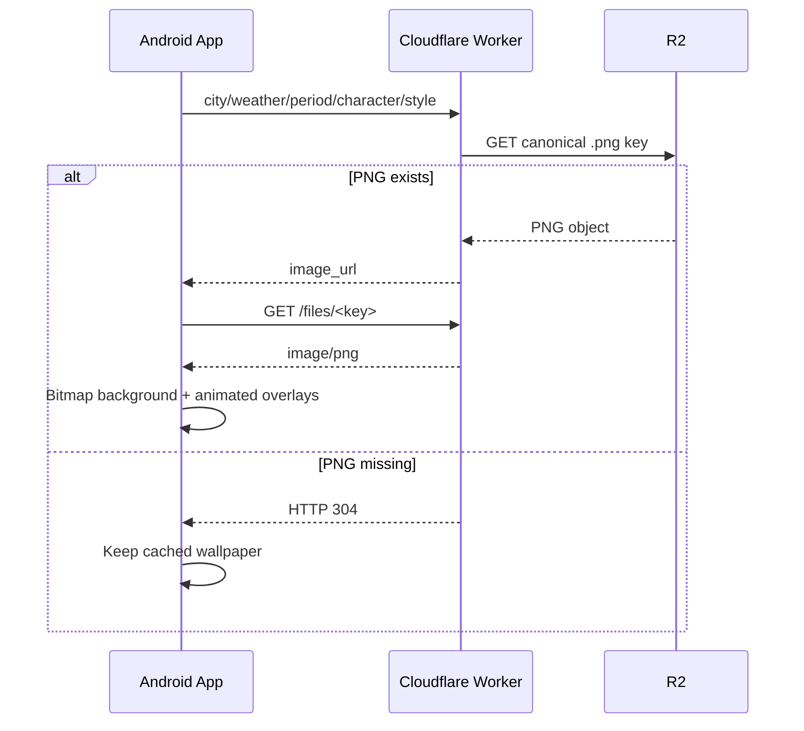
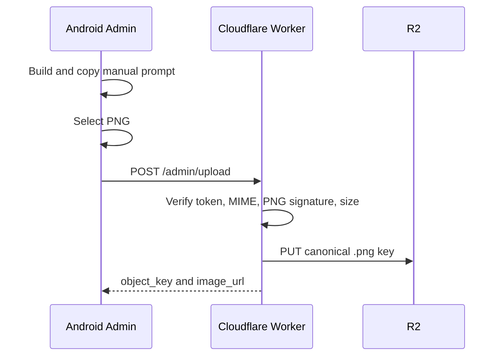

# Amigurumi Weather Theme 技術架構

更新日期：2026-09-20

## 元件

| 元件 | 責任 |
| --- | --- |
| Android Universal App | 查詢、下載及套用 R2 PNG；提供靜態與 Live Wallpaper 模式 |
| Android Admin App | 開發階段產生提示詞並上傳手動 PNG |
| Cloudflare Worker | 天氣相容 API、PNG 驗證、R2 lookup、R2 upload、六時段覆蓋率檢查 |
| Cloudflare R2 | 保存 canonical PNG 桌布 |

Windows Admin、OpenAI Image API 與私人 GitHub in-app updater 均不在目前架構內。

## 讀取流程

## Admin Upload

Upload restrictions:

- PNG only.
- Maximum 12 MiB.
- Worker owns object naming.
- Token is not persisted by the Android App.
- Android backup is disabled.

## Dynamic Wallpaper

`DynamicWallpaperService` loads the cached PNG through `BitmapFactory`, scales it to cover the device Canvas and redraws approximately every 66 ms. `LocalWallpaperRenderer.drawWeatherOverlay()` supplies moving weather effects. This is compatible with Android Live Wallpaper because the animation is performed by `WallpaperService`; no animated image or video file is required.

## Scheduling

Cron runs at six configured UTC hours and maps execution to six Asia/Taipei periods. For the active period it checks R2 coverage for Kaohsiung and Taipei across 2 styles and 5 characters. It uses `head()` only, skips existing keys and logs missing keys. There is no generation or R2 write in the scheduled handler.

## Update And Release Boundary

- Repository: source and text documentation only.
- APKs: not committed, including Admin APKs.
- Private GitHub: not used by the Android client for updates.
- Future updates: publish only the required public client artifact through a separately chosen public channel.

## Verification

`npm.cmd test` covers R2 miss behavior, PNG validation, size limits, canonical naming and scheduled coverage checks. `npm.cmd run cf:check` performs Worker syntax validation. Android build verification is currently unavailable because this workspace intentionally does not contain a complete Java/Gradle/signing toolchain.
